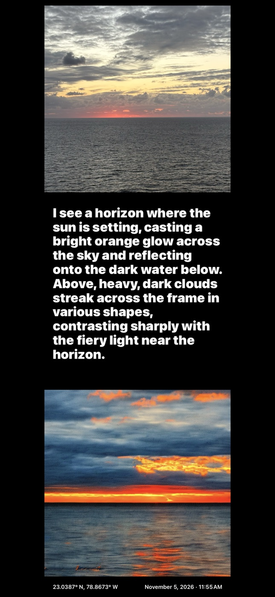

# Thomas

**A camera whose film is language.**

  

Point Thomas at the world and press the shutter. A vision model **describes what it sees**, and those
words are the recording. Then a second model **draws the scene from the words alone**, having never
seen your photograph. One press, three frames:

1. **The photograph**: what the lens saw.
2. **The words**: what the machine perceived, in its own words.
3. **The drawing**: the machine imagining the scene from those words.

**Reality, machine perception, machine imagining.** The gap between the three is the point: a
legible, pointable look at how a machine sees, which is not how you see. Not a worse eye. A
different one.

[Thomas on the App Store](https://apps.apple.com/app/id6796206426) ·
[Website](https://markfriedlander.github.io/Thomas/)

## What is in it

- **The Developer Tray.** Open a recent shot and scrub through how the machine made it: the eye's
  words arriving one at a time, and the drawing resolving out of noise. With a downloaded eye it also
  shows where each word looked on your photograph and the numbers your photo became. Every number in
  it is real; when a model will not show a stage, the Tray shows nothing rather than invent one.
- **The Dark Room.** Load several pictures at once and watch them develop one after another.
- **A real camera.** Zoom from 0.5x to 10x, tap to focus and expose, hold to lock, 4:3 or 16:9.
- **The Guide.** Thomas explains himself, inside the app and searchable.

## Private by design

No accounts, no servers, no analytics, no ads. The drawing always happens on your device. The seeing
can too: choose a downloaded eye and nothing about your photograph leaves it. The built-in Apple
Intelligence eye may use Apple's Private Cloud Compute when you are online, and a place name is looked
up with Apple's mapping service unless you stamp raw coordinates instead. The lock on the camera
screen shows, at every moment, whether anything can leave.

## How it works

- **The eye** is a vision-language model that looks at the photo and writes what it sees: Apple
  Intelligence (built in, no download), or Qwen3.5-2B or SmolVLM2-500M (downloaded, run with MLX).
  Its system prompt and its temperature are yours to read and to change, under those names.
- **The hand** is a Stable Diffusion model that draws from the eye's words: SD-2.1 on the Neural
  Engine through Core ML, or SD-Turbo through MLX. It never sees your photo. (Switch the eye off and
  the hand reads the photo directly instead: the silent loop.)
- **The shot is atomic.** You set it up once, then just shoot. Finished frames land in Photos like a
  print surfacing in a chemical bath: the wait is the film developing.
- **The stamp is visible.** A shot carries its place and time on the frame, a loaded picture the date
  it was taken. Nothing is hidden in the file: Thomas writes no GPS into anything it saves.

## Requirements

iOS 27 or later on an iPhone with Apple Intelligence. Thomas also runs on iPad and on Apple Silicon
Macs (as an iPad app).

## Building it

The Xcode project keeps the app's working name, **AI Camera**.

1. Open `AI Camera/AI Camera.xcodeproj` in Xcode 27 or later. The Swift packages resolve on their own.
2. Set your own development team and bundle identifier.
3. The entitlements ask for the increased memory limit (the models are large) and an App Group,
   `group.com.MarkFriedlander.aifamily`, which lets Thomas share downloaded models with its sibling
   apps. Replace the group with one of your own; Thomas works the same, it just will not share.
4. Run on a device with Apple Intelligence for the words. The drawing models download inside the
   app, from Hugging Face, after you accept each model's license. No model weights live in this
   repository except TAESD's small preview decoder.

Debug builds include a local developer API (port 8767, token-protected) that lets a script drive the
app for testing. Release builds contain none of it. `ThomasUITests` runs Apple's accessibility audit
across the main screens.

## Third-party components

Thomas stands on open work. Packages: [MLX Swift LM](https://github.com/ml-explore/mlx-swift-lm)
(MIT), Apple's [ml-stable-diffusion](https://github.com/apple/ml-stable-diffusion) (MIT), Hugging
Face's [swift-transformers](https://github.com/huggingface/swift-transformers) (Apache 2.0), and
[SharedModelStoreKit](https://github.com/markfriedlander/SharedModelStoreKit) (MIT). Vendored, with
their licenses and a note on why in each folder under `Vendor/`: Stable Diffusion code from
[mlx-swift-examples](https://github.com/ml-explore/mlx-swift-examples) and the Qwen and SmolVLM model
code from MLX Swift LM (all MIT). Bundled: [TAESD](https://github.com/madebyollin/taesd) by Ollin
Boer Bohan (MIT).

Models, downloaded by the user under their own licenses: Stable Diffusion 2.1 (CreativeML
OpenRAIL++-M), SD-Turbo (Stability AI Community License), Qwen3.5-2B and SmolVLM2-500M (Apache 2.0).
**Powered by Stability AI.**

## License

Thomas is released under the MIT License. See [LICENSE](LICENSE).

---

*One of a small family of apps by [Mark Friedlander](https://markfriedlander.github.io/).*
